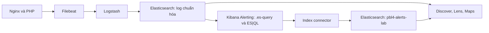

# Bảo — Kibana, dashboard và cảnh báo R1–R4

[← Lộ trình nhóm](README.md) · [Lý thuyết chung](Ly-thuyet-chung.md)

**Khối lượng:** 10 buổi × 2 giờ. **Đầu ra:** ba phiên Discover, một dashboard tự dựng, một bản đồ đọc được, cấu hình bốn rule và biên bản đối chiếu cảnh báo về log nguồn. Dùng PowerShell ở thư mục gốc của bản clone phục vụ lab. Shop đã có sẵn, dùng để phát sinh log. Toàn bộ traffic thử trỏ vào `http://127.0.0.1:8080`. Giữ báo cáo tại `.runtime/evidence/bao/`, ghi mốc UTC và che dữ liệu định danh khi chia sẻ.

Mốc nguồn là nhánh `Maybe_Final` tại commit `a653ae4245002148bcafffaa6040858848c2b484`. Dựng stack theo [lộ trình nhóm](README.md) hoặc [runbook local của dự án](https://github.com/hoangFan1005/PBL4-demo/blob/a653ae4245002148bcafffaa6040858848c2b484/docs/runbooks/local.md). Hoàng bàn giao thao tác HTTP, thời gian và `X-Request-ID`. Trí bàn giao Elasticsearch index, trường và giá trị đã chuẩn hóa. Bảo lần theo tài liệu trong Discover, dựng phép đo và đối soát cảnh báo.

## Đọc luồng log ở đầu Kibana



- **Monitoring** đọc và tổng hợp sự kiện theo time picker. Một dashboard có thể hiện request tăng mà rule vẫn chưa vượt ngưỡng trong cửa sổ riêng. Đếm HTTP từ `nginx.access`, đếm xác thực từ `shop.auth`, đếm chẩn đoán Nginx từ `nginx.error`. Ví dụ, một HTTP 404 có thể chỉ sinh dòng access, còn 403 bị deny ở lab có thể sinh cả access và error.
- **Alerting** chạy ES|QL theo lịch trên Kibana. Khi điều kiện khớp, Index connector ghi một document thông báo vào `pbl4-alerts-lab`. `Security & Access` là tên dashboard của nhóm. Các rule dùng **Stack Management → Rules → Elasticsearch query**, kiểu `.es-query`. Một đợt native có thể có thông báo active, nhắc lại và recovered. Đếm document thông báo sẽ lớn hơn số đợt khi có nhắc lại.
- **Thời gian và độ trễ.** `@timestamp` là lúc sự kiện nguồn xảy ra. `event.ingested` là lúc Elasticsearch ingest. `event.ingested - @timestamp` đo độ trễ ingest. `http.request.duration_sec` đo thời gian xử lý HTTP ở Nginx. Cấu hình Kibana hiển thị múi giờ `Asia/Ho_Chi_Minh` (UTC+7), nên khi đối chiếu thời điểm UTC phải cộng 7 giờ hoặc xem giá trị gốc trong JSON. Trình duyệt thấy log còn phụ thuộc refresh, time picker và thời điểm Elasticsearch trả kết quả.
- **Dữ liệu đủ điều kiện.** Dùng đúng index/dataset, `labels.synthetic == "false"` là chuỗi, bỏ `pbl4.parse_failure == true` khỏi truy vấn rule và baseline. `request.id` nối access với auth. Error có thể thiếu ID, tra bằng thời gian và nội dung đường dẫn trong document. Bản hiện hành làm sạch `event.original` trước khi lưu và đặt `index: false` cho trường này.

[Nguồn cấu hình Kibana](https://github.com/hoangFan1005/PBL4-demo/tree/a653ae4245002148bcafffaa6040858848c2b484/infra/kibana) · [Hợp đồng dữ liệu](https://github.com/hoangFan1005/PBL4-demo/blob/a653ae4245002148bcafffaa6040858848c2b484/CONTRACT.md) · [Elastic — Elasticsearch query rule](https://www.elastic.co/docs/explore-analyze/alerting/alerts/rule-type-es-query)

## Tuần 1 — Từ một document tới dashboard và baseline

### Buổi 1 — Chốt trạng thái ban đầu và đọc một request thật

**20 phút lý thuyết · 70 phút thực hành · 30 phút chốt bằng chứng**

1. Kiểm tra đúng commit và môi trường. Dùng đầu ra `--check-only` để đọc cấu trúc đầu vào. Đây là kiểm tra tĩnh. Docker cần chạy ở chế độ Linux containers để kiểm tra runtime.

   ```powershell
   git rev-parse HEAD
   python scripts/bootstrap/install_kibana.py --check-only
   docker compose ps
   New-Item -ItemType Directory -Path .runtime/evidence/bao -Force | Out-Null
   ```

2. Khi Trí đã cài index/template và stack healthy, chạy verifier Kibana trước buổi bật rule. Nó cài hai lần để thử tính lặp lại, đọc lại saved objects, chạy truy vấn panel và xuất NDJSON. Nó để bốn rule ở trạng thái disabled. Nếu đang có lượt thử live của nhóm, đặt lịch chạy trước khi bắt đầu lượt đó.

   ```powershell
   python scripts/verify/kibana.py --output .runtime/evidence/bao/kibana.json
   ```

3. Mở `https://localhost:5601` với public CA của lab và thông tin đăng nhập local theo runbook. Tạo một 404 có dấu nhận biết rồi lưu UTC, status và request ID. Trong Discover chọn **PBL4 | HTTP Access**, Last 15 minutes và lọc theo ID nhận được.

   ```powershell
   $probe = 'pbl4-bao-' + [guid]::NewGuid().ToString('N')
   [DateTimeOffset]::UtcNow.ToString('o')
   curl.exe -sS -D - -o NUL "http://127.0.0.1:8080/$probe"
   ```

   ```kql
   event.dataset: "nginx.access" and labels.synthetic: "false" and request.id: "<ID-từ-header>"
   ```

**Đạt:** HTTP 404, đúng một document access có cùng ID và path, thấy `@timestamp` lẫn `event.ingested` khi mở document. Gửi một dòng kết quả cho Hoàng và Trí. Ghi riêng môi trường runtime nếu verifier báo `FAIL` hoặc `BLOCKED`.

### Buổi 2 — Tự tạo data view và phiên Discover

**20 phút lý thuyết · 80 phút thực hành · 20 phút chốt bằng chứng**

1. Data view chọn index và trường thời gian. Saved Discover session giữ data view, query, thứ tự và cột. Đọc `infra/kibana/definitions/data_views.json` và `searches.json`, sau đó vào **Stack Management → Data Views → Create data view**. Tạo các view có tên bắt đầu bằng `Lab Bảo`, với time field `@timestamp`.

   | View | Index pattern | Cột chính trong Discover |
   |---|---|---|
   | Lab Bảo Access | `logs-nginx.access-lab-*` | `@timestamp`, `source.ip`, `http.request.method`, `url.path`, `http.response.status_code`, `request.id` |
   | Lab Bảo Auth | `logs-shop.auth-lab-*` | `@timestamp`, `source.ip`, `event.action`, `event.outcome`, `request.id` |
   | Lab Bảo Error | `logs-nginx.error-lab-*` | `@timestamp`, `log.level`, `source.ip`, `event.original` |

2. Vào Discover, chọn từng view, thêm cột, sắp xếp theo `@timestamp` giảm dần, thêm KQL `labels.synthetic: "false"` rồi lưu từng session với tên tương ứng. Giữ object của lab có tên riêng để còn so sánh với bản cài từ repo.
3. Mở một phiên auth, lọc `event.action: "login_failed"`, mở document, chép `request.id` và dùng ID đó tìm access. Nếu nhóm chưa phát auth, trên shop dùng tài khoản lab và thử một lần sai có kiểm soát. Với phiên error, thu hẹp time picker và đọc `event.original` trong document. Xem riêng data view **PBL4 quarantined logs** và **PBL4 synthetic fixtures (isolated)** để biết dữ liệu bị tách theo index.

**Đạt:** ba phiên lưu mở đúng index và một người khác có thể tra cùng ID từ access sang auth. Ghi thêm một ví dụ thời gian có dữ liệu và một khoảng không có dữ liệu để dùng lại buổi 3.

### Buổi 3 — Dựng Lens và Maps từ dữ liệu thật

**20 phút lý thuyết · 80 phút thực hành · 20 phút chốt bằng chứng**

1. Mở **Dashboards → Create dashboard**, đặt tên `Lab Bảo | Log Diagnostics`. Thêm panel **Create visualization (query)** hoặc mục **ES|QL**. Dùng truy vấn sau và chọn kiểu **Metric**, trường `count`, tiêu đề **Access**.

   ```esql
   FROM logs-nginx.access-lab-*
   | WHERE event.dataset == "nginx.access" AND labels.synthetic == "false"
   | WHERE @timestamp > TO_DATETIME(?_tstart) AND @timestamp <= TO_DATETIME(?_tend)
   | STATS count = COUNT(*)
   ```

2. Tạo thêm **Auth** và **Error**. In đúng query dự án để so sánh với truy vấn tự viết. Auth tính cả `login_success` và `login_failed`. Thêm panel bảng `source-events` cho số dòng, sự kiện mới nhất và thời gian ingest mới nhất theo nguồn. Dùng màu Access `#1D4ED8`, Auth `#6D28D9`, Error `#B45309`. Tạo panel Markdown trỏ tới ba session vừa lưu bằng URL Kibana tương đối. Dùng khoảng thời gian tuyệt đối khi đối chiếu số đếm để hai tab dùng cùng cửa sổ.

   ```powershell
   $diagnostics = Get-Content -Raw infra/kibana/definitions/diagnostics.json | ConvertFrom-Json
   $diagnostics.panels |
       Where-Object { $_.id -in @('source-auth','source-error','source-events','ingest-latency','country','geoip-status') } |
       ForEach-Object { [pscustomobject]@{ panel = $_.id; query = $_.config.data_source.query } } |
       Format-List
   ```

3. Thêm bảng `ingest-latency` hoặc đọc biểu thức `DATE_DIFF("millisecond", @timestamp, event.ingested)` ở panel gốc. Mở ba dashboard quản lý để tìm chỉ số tương ứng. **Service Overview** có tỷ lệ 5xx và p95 HTTP. **Security & Access** có kết quả đăng nhập, 429 và lịch sử thông báo. **Log Diagnostics** có độ phủ nguồn, quarantine, độ trễ ingest và GeoIP.
4. Trong **Maps → Create map**, thêm **EMS Boundaries → World Countries** làm nền xám. Thêm **Choropleth → World Countries**, chọn view Access, join `iso2` với `source.geo.country_iso_code`, metric Count. Thêm **Documents** với trường địa lý `source.geo.location` và áp dụng KQL access thật cho truy vấn dữ liệu. Lưu rồi thêm map từ library vào dashboard. Đối chiếu bảng `country` bên cạnh để thấy **Unknown**. Mã quốc gia không kèm tọa độ vẫn có thể tô polygon; lớp Documents chỉ vẽ tọa độ thực sự lưu trong ES.

**Đạt:** ba ô đếm và liên kết Discover khớp một cửa sổ cố định. Kiểm thêm cửa sổ trống. Nếu local chỉ có IP private, ghi quan sát Unknown và nền tham chiếu. Nếu EMS không tải, ghi riêng lỗi browser/EMS và vẫn đối chiếu bảng quốc gia. Ảnh từ đợt AWS 12/11 là mốc tham khảo đã ghi ngày, còn kiểm chứng màn hình local phải ghi từ buổi lab.

[Elastic — Lens với ES|QL](https://www.elastic.co/docs/explore-analyze/visualize/esorql) · [Elastic — Maps term join](https://www.elastic.co/docs/explore-analyze/visualize/maps/terms-join) · [Kết quả AWS 12/11/2026](https://github.com/hoangFan1005/PBL4-demo/blob/a653ae4245002148bcafffaa6040858848c2b484/docs/final-aws-verification-2026-11-12.md)

### Buổi 4 — Tự viết ES|QL và chuẩn bị đo baseline

**30 phút lý thuyết · 70 phút thực hành · 20 phút chốt lịch đo**

| Luật | Truy vấn dùng log nào | Nhóm, cửa sổ và ngưỡng |
|---|---|---|
| R1 | Access thật | Theo IP, 1 phút, số request **> 50** |
| R2 | Auth thật, `login_failed` | Theo IP, 5 phút, số lần **≥ 5** |
| R3 | Access thật, HTTP 404 | Theo IP, 5 phút, số 404 **≥ 20** và số `url.path` khác nhau **≥ 10** |
| R4 | Access thật | Toàn site, 1 phút, số request **> max(100, 3 × B)** |

1. Mở **Dev Tools**. Dùng truy vấn dưới để xem đếm theo IP trên một phút gần hiện tại. Lần lượt bỏ/thêm `STATS` và `WHERE count > 50` để hiểu cách một nhóm trở thành một dòng kết quả. Lúc tải thấp, thêm ngưỡng sẽ cho 0 dòng. Đây là thử truy vấn trực tiếp.

   ```http
   POST /_query?allow_partial_results=false
   {
     "query": "FROM logs-nginx.access-lab-* | WHERE event.dataset == \"nginx.access\" AND labels.synthetic == \"false\" AND source.ip IS NOT NULL | WHERE @timestamp > NOW() - 1 minute AND @timestamp <= NOW() | WHERE pbl4.parse_failure IS NULL OR pbl4.parse_failure == false | STATS count = COUNT(*) BY source.ip | SORT count DESC"
   }
   ```

2. Dựa vào bảng để tự viết R2, R3, R4. Với R3, nhóm theo cặp IP và path trước, sau đó cộng lượt và đếm số nhóm path theo IP. Với R4, bỏ `BY source.ip`. So với `detection/queries/R1.esql` đến `R4.esql`. Truy vấn native nhận `?_tstart`/`?_tend` để dùng chính xác cửa sổ `(start, end]`. Các file gốc còn giữ `VALUES(request.id)` phục vụ đối soát.
3. Dùng `install_kibana.py` để cài đầy đủ cấu hình gốc nếu chưa cài. Mở **Stack Management → Rules**, kiểm tra type, lịch **30 giây**, nhóm theo dòng R1–R3 và nhóm toàn bộ R4. Kiểm tra **Connectors → PBL4 alert history** trỏ `pbl4-alerts-lab`. Action `query matched` nhắc lại theo throttle 5 phút trong cùng đợt, action `recovered` ghi theo chuyển trạng thái. Tập ID được serialize qua action rồi ingest split thành mảng. Ngưỡng nằm trong truy vấn, còn giao diện chỉ xác định điều kiện có dòng khớp. Với R4 chưa có baseline, mã cài dùng `WHERE false` và giữ rule tắt.

   ```powershell
   python -m unittest discover -s tests/detection -v
   python tests/detection/engine_test.py --output .runtime/evidence/bao/esql-engine.json
   python tests/detection/kibana_engine_test.py --output .runtime/evidence/bao/kibana-engine.json --timeout-seconds 300
   ```

4. Chốt một cửa sổ 30 phút với Hoàng và Trí cho buổi 5. Shop healthy, đã seed, ba index thật truy vấn được, rule tắt, nhóm ngừng tạo burst/scan và drill trong thời gian đo. Kiểm trước lỗi thiếu kiểu `.es-query` hay connector `.index`, quyền, license và API. Hai harness native ở bước 3 dùng dữ liệu synthetic cô lập và báo riêng khả năng thực thi query/action.

**Đạt:** giải thích được vì sao R2 dùng auth, R3 có hai điều kiện, R4 có baseline và lịch 30 giây khác cửa sổ 1/5 phút. Ghi giờ hẹn đo, trạng thái từng bộ kiểm tra và nguyên nhân nếu môi trường chặn thử native.

[Nguồn truy vấn và rule](https://github.com/hoangFan1005/PBL4-demo/tree/a653ae4245002148bcafffaa6040858848c2b484/detection) · [Mã cài Kibana](https://github.com/hoangFan1005/PBL4-demo/blob/a653ae4245002148bcafffaa6040858848c2b484/scripts/bootstrap/install_kibana.py)

### Buổi 5 — Đo 30 phút thật, bật rule và chạy đối chứng

**20 phút chuẩn bị · 55 phút đo và bật rule · 45 phút đối chứng và chốt tuần**

1. B là trung bình request access thật/phút, kể cả phút có 0 request. Dùng đúng 30 phút khép kín. Chạy một tiến trình PowerShell dưới đây, từ checkout lab đã có index và Kibana. Script gửi sáu thao tác duyệt nhẹ cho mỗi phút hoạt động, để mỗi phút thứ năm không phát từ script. Các request access thật khác như `/health.php` có thể xuất hiện trong phút đó. Health check nội bộ tại `/health` có `access_log off` trong cấu hình local. Trong lúc đợi, cả nhóm đọc mapping và chuẩn bị bảng đối chứng, giữ traffic khác khỏi lab.

   ```powershell
   $labUrl = 'http://127.0.0.1:8080'
   $start = [DateTimeOffset]::FromUnixTimeSeconds([DateTimeOffset]::UtcNow.ToUnixTimeSeconds() + 3)
   $end = $start.AddMinutes(30)
   for ($minute = 0; $minute -lt 30; $minute++) {
       $tick = $start.AddMinutes($minute).AddSeconds(1)
       while ([DateTimeOffset]::UtcNow -lt $tick) { Start-Sleep -Milliseconds 250 }
       if ($minute % 5 -ne 4) {
           python scripts/traffic/run.py baseline --target $labUrl --count 6 --rate 1
           if ($LASTEXITCODE -ne 0) { throw 'Traffic baseline lỗi. Ghi lý do và chạy lại cửa sổ mới.' }
       }
   }
   while ([DateTimeOffset]::UtcNow -lt $end.AddSeconds(30)) { Start-Sleep -Seconds 1 }
   python scripts/detection/baseline.py --live --start $start.ToString('o') --end $end.ToString('o') --output .runtime/evidence/bao/baseline.json
   ```

2. Đọc `baseline.json` trong máy lab. Kiểm `mode=live-elasticsearch`, đủ 30 bucket, `total_requests` bằng tổng bucket, `requests_per_minute` bằng tổng/30 và `r4_threshold=max(100,3B)`. Đối chiếu một phút bằng Elasticsearch, ghi rõ tải demo có kiểm soát. Nếu lỗi profile, traffic ngoài kế hoạch hoặc thiếu bucket, đo lại trước khi bật. Gate của nhóm là mẫu truy vấn được, đủ bucket và hai đối chứng thực thi, mỗi lượt 0 action mới.

   ```powershell
   python scripts/bootstrap/install_kibana.py --baseline .runtime/evidence/bao/baseline.json
   ```

3. Trong Rules, kiểm tra đủ bốn rule bật và cấu hình R4 đã thay ngưỡng. Chạy hai lượt đối chứng tách nhau theo thời gian. Lượt 1 duyệt ít request. Lượt 2 đăng nhập thành công từ trình duyệt và phát bốn 404 trên hai path. Mỗi lượt lưu UTC đầu/cuối, cho rule ít nhất 90 giây để đánh giá rồi xem log nguồn đã index, execution của rule và lịch sử action trong cửa sổ lượt thử.

   ```powershell
   python scripts/traffic/run.py baseline --target $labUrl --count 12 --rate 1
   # Sau khi đã kiểm tra lượt 1, ghi mốc UTC mới và đăng nhập thành công trên shop lab.
   python scripts/traffic/run.py scan404 --target $labUrl --count 4 --distinct 2 --rate 2
   ```

**Đạt tuần 1:** lưu baseline thật, kết quả readback cấu hình và hai đối chứng có log nguồn, có thực thi rule, 0 action mới. Chốt bằng chứng cùng Hoàng và Trí. Lượt học này xác nhận cách bật và đo baseline. Dùng runner đầy đủ ở buổi 7 để kiểm toàn bộ vòng đời theo bộ tiêu chí của repo.

## Tuần 2 — Tích hợp, diễn tập lỗi và demo

### Buổi 6 — Từ HTTP đến alert và trở ngược về log

**15 phút lý thuyết · 85 phút thực hành · 20 phút bàn giao**

1. Nhận ba mẫu của Hoàng và bản ghi đã chuẩn hóa từ Trí. Mở Discover trên cùng khoảng UTC rồi quy đổi giờ hiển thị. Tìm 404 theo ID, tìm 401 theo cùng ID trong Access và Auth, tìm error 403 bằng time picker và URI trong `event.original`. Mở `Log Diagnostics` để đọc nguồn mới nhất và độ trễ ingest. Dùng `url.path` để tra Access, xem nội dung document khi tra Error.
2. Nếu gate buổi 5 đã đạt, chốt UTC mới rồi chạy mẫu dương trên localhost. Ví dụ dưới dùng khi ngưỡng R4 **< 120**. Nếu ngưỡng khác, đọc runbook và chọn tải có kiểm soát đủ vượt ngưỡng trong một phút, tối đa 500 request và 10 request/giây theo script. Xác minh đủ sự kiện có thể truy vấn đúng cửa sổ trước khi kết luận.

   ```powershell
   $labUrl = 'http://127.0.0.1:8080'
   [DateTimeOffset]::UtcNow.ToString('o')
   python scripts/traffic/run.py burst --target $labUrl --count 120 --rate 5
   python scripts/traffic/run.py login-fail --target $labUrl --count 5 --rate 1
   python scripts/traffic/run.py scan404 --target $labUrl --count 20 --distinct 10 --rate 2
   ```

   `login-fail` lấy form/CSRF rồi thực hiện năm POST 401. Nếu gặp 429, kiểm tra trạng thái bảo vệ và dành cửa sổ mới sau cooldown. Dùng số sự kiện `shop.auth` đúng loại để đánh giá.
3. Vào Discover với **PBL4 alert history**, lọc `pbl4.state: "active"` và chỉ lấy cửa sổ vừa phát tải. Mở một alert R3, đọc `pbl4.observed_count`, `pbl4.unique_uri_count`, `pbl4.window_start`, `pbl4.window_end` và `pbl4.source_request_ids`. Dùng một ID để mở dòng access 404. R4 có phạm vi toàn site. Đọc lại cùng thông báo ở **Security & Access**, xem `kibana.alert_uuid` và phân biệt mốc phát action với mốc log nguồn.

**Đạt:** cùng nhóm trình bày một chuỗi đầy đủ `HTTP → access/auth/error → index → Discover` và một chuỗi `rule → action → ID → log nguồn`. Ghi từng rule dương `PASS` hoặc `FAIL` theo action tìm thấy trong đúng cửa sổ. Ghi `BLOCKED` nếu gate baseline hoặc runtime chưa sẵn sàng. Bảo giữ bảng UTC, ID và đầu mối xử lý nếu một lớp thiếu dữ liệu.

### Buổi 7 — Chạy acceptance native và đọc vòng đời

**15 phút chuẩn bị · 85 phút chạy · 20 phút tổng hợp**

1. Thống nhất lab riêng, stack khỏe, dừng các bài thử song song. Chạy bộ kiểm chứng dài. Runner tạo baseline thật mới, bật bốn rule, chạy đối chứng, kiểm biên và vòng đời. Trong lúc chạy, đọc `docs/runbooks/detection.md`, theo dõi các pha và ghi tên pha/giờ UTC khi có lỗi. Nếu kéo dài hơn dự trù, ghi tiến độ và để lượt hiện tại hoàn tất trước khi đụng traffic/rule.

   ```powershell
   python scripts/verify/live_detection.py --target http://127.0.0.1:8080 --baseline-minutes 30 --output .runtime/evidence/bao/live-detection.json
   ```

2. Đọc report. Tự lập bảng đối chiếu R1 50/51, R2 4/5, R4 ngay hai phía ngưỡng, và R3 20/10 ở pha dương. Từ một active action, đối chiếu số `request.id` hợp lệ với `observed_count` và các path khác nhau nếu là R3. Dùng đúng tập ID trong action và đúng cửa sổ, ghi nhận riêng log tìm thêm ngoài snapshot.
3. Giải thích vòng đời bằng alert UUID. Lượt active, nhắc lại cách nhau ít nhất 300 giây trong cùng đợt, recovery sau khi điều kiện hết và active trở lại sau kích hoạt mới. Recovery giữ định danh alert và có thể thiếu IP/count mới. Phân biệt độ trễ backend E13a/E13c và E13b thấy trên browser. E13b nằm ở phép kiểm riêng của browser, với hướng dẫn môi trường theo [runbook Windows](https://github.com/hoangFan1005/PBL4-demo/blob/a653ae4245002148bcafffaa6040858848c2b484/docs/runbooks/windows.md).

**Đạt:** báo cáo có trạng thái thực của từng pha, có baseline kèm theo, một đối chứng âm và một cảnh báo được đối chiếu về ID. Chỉ ghi nghiệm thu backend khi `contract_acceptance` là `PASS`. Khi lỗi, giữ report nguyên và xác định pha cần sửa trước khi chạy lại.

[Runbook detection](https://github.com/hoangFan1005/PBL4-demo/blob/a653ae4245002148bcafffaa6040858848c2b484/docs/runbooks/detection.md)

### Buổi 8 — Drill mất log và phân biệt lỗi hiển thị

**20 phút lý thuyết · 75 phút diễn tập · 25 phút viết biên bản**

1. Trước drill, chọn marker mới và cửa sổ tuyệt đối chứa marker. Đặt time picker về khoảng quá khứ để thấy bảng trống dù Elasticsearch vẫn có ID. Khôi phục khoảng đúng, kiểm data view và KQL. Đây là lỗi điều kiện quan sát.
2. Phối hợp Hoàng cho Filebeat dừng trong một lượt ngắn trên lab, ngoài thời gian chạy acceptance. Hoàng tạo một marker 404 và xác nhận Nginx có dòng tương ứng. Trí kiểm log chưa vào Elasticsearch. Bảo tìm ID trong Discover với đúng cửa sổ để ghi kết quả trước khôi phục.
3. Khi Hoàng khởi động lại Filebeat, bấm refresh, giữ nguyên cửa sổ UTC và lọc chính ID cũ. Trí xác nhận trạng thái index, Bảo ghi số dòng và thời điểm thấy. Nếu ES đã có mà Discover chưa có, ưu tiên time picker, data view, KQL và refresh. Nếu log nguồn có mà Elasticsearch chưa có, Hoàng/Trí kiểm Filebeat, TLS, Logstash và quarantine.
4. Mở Security & Access. Với một lượt không có thông báo, kiểm theo thứ tự **có log đủ điều kiện → query trả dòng → rule enabled và execution OK → connector ghi đúng index → time picker lịch sử**. So sánh trường hợp không đủ ngưỡng với trường hợp lỗi thu thập hoặc connector. Nếu map thiếu điểm, xem `pbl4.geoip_status` và lớp EMS trước khi kết luận.

**Đạt:** ghi hai lỗi có triệu chứng bảng trống nhưng nguyên nhân khác nhau, có UTC, ID, bằng chứng trước/sau và hành động khôi phục. Thử nghiệm một ID chứng minh lần drill này, còn đánh giá backlog/duplicate đọc theo verifier riêng.

### Buổi 9 — Kiểm tra chạy lại và xuất cấu hình

**15 phút chuẩn bị · 80 phút kiểm tra · 25 phút rà bằng chứng**

1. Cùng nhóm dựng lại từ checkout sạch cùng commit, project mới `pbl4-hoc-bao-lap-lai` và bộ secret/CA riêng. Chạy bootstrap và trace trong cùng ngày UTC theo [README](README.md). Dừng project cũ trước để giải phóng cổng. Giữ báo cáo của project cũ để đọc kết quả live buổi 7. Kiểm chứng project mới khi bốn rule đang tắt như lần cài đầu.

   ```powershell
   python scripts/bootstrap/install_kibana.py --check-only
   python scripts/verify/kibana.py --output .runtime/evidence/bao/kibana.json
   python -m unittest discover -s tests/tooling -p test_dashboard_content.py -v
   ```

2. Mở lại ba dashboard. Tạo marker mới trong project mới, chọn cửa sổ cố định, so ba ô đếm với bảng nguồn, kiểm màu và mở ba liên kết Discover. Kiểm cả cửa sổ trống để biết rate/p95 hiển thị thế nào khi thiếu mẫu. Chụp enabled, lịch, grouping và query trong Rules trước/sau `--dashboards-only` để xác nhận cập nhật UI giữ cấu hình rule. Khi trở lại project cũ đã bật rule, dùng cùng lệnh để thử giữ trạng thái đang bật.

   ```powershell
   python scripts/bootstrap/install_kibana.py --dashboards-only
   ```

3. Dùng export tạo ở bước 1 để kiểm import saved objects trong Space dùng một lần. Kiểm roundtrip rule với trạng thái mặc định đang tắt trên project mới. Nếu kiểm thêm project cũ đang bật, truyền đúng `--baseline` của lượt đã cài và xác minh rule vẫn đang dùng baseline đó trước khi đọc lại.

   ```powershell
   python scripts/verify/kibana_roundtrip.py --export .runtime/evidence/bao/kibana-export.ndjson --output .runtime/evidence/bao/kibana-roundtrip.json
   python scripts/verify/rule_roundtrip.py --export .runtime/evidence/bao/rules-export.json --output .runtime/evidence/bao/rules-roundtrip.json
   ```

**Đạt:** một thành viên khác dựng lại lab, mở được ba phiên quản lý và truy lại đúng marker mới. Lưu trạng thái roundtrip thực tế. Ghi riêng kiểm tra API/queries, render browser/EMS và live lifecycle. Rà nội dung trước khi đưa ảnh hay mẫu log vào tài liệu nhóm.

### Buổi 10 — Demo và đổi vai

**20 phút kiểm môi trường · 60 phút tập và diễn · 40 phút đổi vai, chốt bàn giao**

1. Trước demo, kiểm tra Kibana, log gần đây, thời gian hiển thị, baseline và rule enabled nếu sẽ phát tải. Mở sẵn ba tab **Log Diagnostics**, **Discover**, **Security & Access**. Ghim UTC của cửa sổ đối chứng và chọn một action đã xác minh trên lab để trình bày vòng đời.
2. Trình bày phần Bảo trong 3–4 phút. Mở ô Access → Discover → dán ID từ Hoàng. Mở Auth cho thao tác đăng nhập và nói rõ cách đối chiếu error 403. Chỉ một lần chuyển sang Security & Access để đọc action R3, lấy một ID từ snapshot và trở lại log 404. Đọc cả ngưỡng và thời gian. Giải thích nhanh vì sao R4 toàn site, vì sao nguồn private có thể hiện Unknown và vì sao nhiều thông báo có thể thuộc cùng đợt.
3. Đổi vai: Trí thao tác Kibana theo hướng dẫn Bảo. Bảo nhận ID từ Hoàng, tự kiểm một dòng file nguồn và chỉ index đích. Hoàng tự mở log đã được Bảo truy ra từ action. Trình bày bằng chứng buổi 7 có ngày giờ khi nói về recovery/retrigger. Một lần refresh trong demo chỉ ghi nhận điều nhìn thấy ở lần refresh đó.
4. Chốt bàn giao với bốn mục: **ID và UTC**, **index + dataset + trường**, **rule và điều kiện**, **bằng chứng + phạm vi kiểm**. Ghi lý do và lớp cần kiểm tiếp cho mọi mục còn `FAIL`, `BLOCKED` hoặc `NOT RUN`.

**Đạt:** một thành viên khác tái hiện được hành trình từ ID đến log và từ alert đến dòng nguồn. Bảo giải thích được vì sao monitor, alert notification và alert episode cho ba số đếm khác nhau.

[Kịch bản demo của dự án](https://github.com/hoangFan1005/PBL4-demo/blob/a653ae4245002148bcafffaa6040858848c2b484/docs/runbooks/demo.md)
