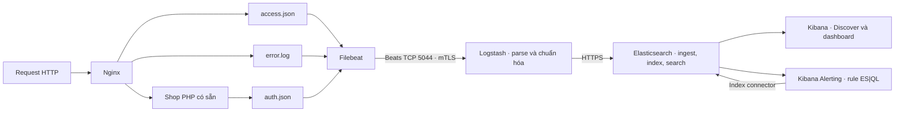

# Lý thuyết chung · Luồng log và ELK

[Về lịch học](README.md) · [Hoàng](Hoang.md) · [Trí](Tri.md) · [Bảo](Bao.md)

## 1. Đọc luồng trước khi đọc cấu hình

Một **request HTTP** có thể tạo nhiều **sự kiện**. Access log ghi kết quả HTTP. Auth log ghi kết quả xác thực trong ứng dụng. Error log ghi chẩn đoán của Nginx. Ví dụ đăng nhập sai tạo một access 401 và một auth `login_failed`. Một URL 404 thông thường có access log. Request vào đường dẫn ẩn bị Nginx từ chối có thể dùng để tìm cả access 403 và error log.



**ELK** gồm Elasticsearch (lưu trữ và truy vấn), Logstash (xử lý sự kiện) và Kibana (giao diện phân tích và cấu hình cảnh báo). Filebeat là shipper. Trong dự án, Filebeat đọc dòng mới từ file và gửi `message` cùng nhãn do cấu hình input cấp. Logstash parse và chuẩn hóa. Elasticsearch xử lý ingest cuối cùng, áp mapping và index document. Kibana đọc và truy vấn Elasticsearch. [Kiến trúc Elastic Stack](https://www.elastic.co/docs/get-started/the-stack) · [Handoff của PBL4](https://github.com/hoangFan1005/PBL4-demo/blob/a653ae4245002148bcafffaa6040858848c2b484/CODEX_HANDOFF.md)

## 2. Ba nguồn và cách nối một request

| Dataset | File trong container nguồn | Dạng thô | Cách đối chiếu |
| --- | --- | --- | --- |
| `nginx.access` | `/var/log/nginx/access.json` | JSON một dòng/request | Header trả về `X-Request-ID` → `request_id` → `request.id` sau parse |
| `shop.auth` | `/var/log/shop/auth.json` | JSON lồng nhau, có `event.action` | Nginx truyền ID qua FastCGI `REQUEST_ID`. Dùng cùng `request.id` để nối access và auth |
| `nginx.error` | `/var/log/nginx/error.log` | Text của Nginx, có mức log | Ghép UTC và đường dẫn/dấu kiểm khi có, vì dòng error thường thiếu ID |

`request.id` là khóa liên hệ, còn Elasticsearch `_id` định danh một document. Hai document access/auth có thể chia sẻ `request.id` mà có `_id` khác nhau. R2 đếm sự kiện auth `login_failed`. Mã HTTP 401 tự nó chỉ nói về kết quả HTTP. Ở máy cá nhân, `source.ip` có thể là IP mạng nội bộ hoặc địa chỉ qua Docker. Header chuyển tiếp do client gửi thiếu căn cứ để dùng làm danh tính. [Ba nguồn log](https://github.com/hoangFan1005/PBL4-demo/blob/a653ae4245002148bcafffaa6040858848c2b484/docs/log-sources.md) · [Cấu hình Nginx](https://github.com/hoangFan1005/PBL4-demo/blob/a653ae4245002148bcafffaa6040858848c2b484/infra/nginx/nginx.conf)

## 3. Từ dòng thô đến document

1. **Filebeat mở file.** Ba `filestream` có ID riêng, đọc cả tên file hiện tại và mẫu file đã xoay vòng. Volume chứa log được mount chỉ đọc. Registry trong volume `filebeat_data` lưu tiến độ đọc, giúp shipper tiếp tục sau khởi động lại. Với gián đoạn, đo ID thiếu hoặc lặp trong đúng ca thử. [Cấu hình Filebeat](https://github.com/hoangFan1005/PBL4-demo/blob/a653ae4245002148bcafffaa6040858848c2b484/infra/filebeat/filebeat.yml)
2. **Hai đầu xác thực qua mTLS.** Filebeat kiểm tra CA và tên máy trong chứng chỉ Logstash. Logstash yêu cầu chứng chỉ client do CA tin cậy cấp. TCP thông chỉ chứng minh cổng có thể truy cập. `filebeat test output` kiểm tra thêm giao tiếp thực với Logstash. [Filebeat và mTLS](https://www.elastic.co/docs/reference/beats/filebeat/configuring-ssl-logstash)
3. **Logstash parse theo dataset.** `00-input.conf` nhận Beats. `10-normalize.conf` gọi `normalize.rb`, rồi thêm thông tin user agent và GeoIP khi có điều kiện. Nhãn `event.dataset` và `labels.synthetic` đi theo input tin cậy. Parser kiểm tra kiểu dữ liệu, chọn trường được lưu và chọn index đích. `90-output.conf` gửi qua HTTPS với tài khoản ghi riêng. [Pipeline Logstash](https://github.com/hoangFan1005/PBL4-demo/tree/a653ae4245002148bcafffaa6040858848c2b484/infra/logstash) · [ECS trong Logstash](https://www.elastic.co/docs/reference/logstash/ecs-ls)
4. **Elasticsearch áp template rồi ghi index.** Index là nơi chứa document. Template quy định mapping và thiết lập khi index mới được tạo. Mapping giúp status là số `long`, ID là `keyword` để lọc đúng giá trị, IP có kiểu `ip` và tọa độ có kiểu `geo_point`. Pipeline `pbl4-ingested` thêm `event.ingested` từ lúc Elasticsearch nhận dữ liệu. Cài các đối tượng trước log đầu tiên để mapping không bị suy ra từ một mẫu bất thường. [Template và ingest của dự án](https://github.com/hoangFan1005/PBL4-demo/tree/a653ae4245002148bcafffaa6040858848c2b484/infra/elasticsearch) · [Elasticsearch ingest pipelines](https://www.elastic.co/docs/manage-data/ingest/transform-enrich/ingest-pipelines)

**Lưu ý khi đọc tài liệu cũ.** Ở commit tham chiếu, `event.original` trong Elasticsearch chứa nội dung đã làm sạch theo parser hiện hành. Access bỏ query string, làm rỗng referrer và XFF trong bản được lưu ở `event.original`. Auth có thể giữ `user.id` số hợp lệ, bỏ `user.name`. Error có lọc chuỗi nhạy cảm. Khi parse lỗi, script bỏ `event.original` và giữ chẩn đoán ngắn qua `pbl4.failure_reason`. Dòng thô nằm ở file nguồn. Tra lỗi bằng dataset, thời gian và loại lỗi, rồi mở file nguồn cục bộ nếu cần. [Parser `normalize.rb`](https://github.com/hoangFan1005/PBL4-demo/blob/a653ae4245002148bcafffaa6040858848c2b484/infra/logstash/normalize.rb)

### Thời gian và routing

| Trường hoặc đích | Ý nghĩa |
| --- | --- |
| `@timestamp` | Giờ phát sinh log được chuẩn hóa UTC. Cửa sổ dashboard và rule dựa vào trường này |
| `event.ingested` | Giờ ingest trên Elasticsearch. Hiệu với `@timestamp` cho biết độ trễ đến ingest |
| `logs-nginx.access-lab-YYYY.MM.dd` | Access thật, `labels.synthetic: "false"` |
| `logs-shop.auth-lab-YYYY.MM.dd` | Auth thật, `labels.synthetic: "false"` |
| `logs-nginx.error-lab-YYYY.MM.dd` | Error thật, `labels.synthetic: "false"` |
| `logs-failed-lab-YYYY.MM.dd` | Sự kiện bị cách ly vì lỗi parse/kiểm tra dữ liệu. Xem `pbl4.parse_failure` và `pbl4.failure_reason` |
| `logs-DATASET-YYYY.MM.dd-synthetic` | Fixture mô phỏng được gắn nhãn `"true"` bởi input dành cho bài thử |
| `pbl4-alerts-lab` | Lịch sử action do connector của Kibana ghi |

Tên index log hợp lệ dùng ngày UTC của sự kiện. Với parse lỗi, ngày routing là ngày UTC lúc xử lý. Kibana của bản này hiển thị theo `Asia/Ho_Chi_Minh`. Khi đối chiếu bằng chứng ISO UTC và chọn khoảng giờ trên giao diện, nhớ **08:15 UTC+7 = 01:15 UTC**. Nếu dashboard rỗng, kiểm khoảng thời gian và index của mẫu. Trạng thái GeoIP `not_public`, `no_source_ip` hoặc `lookup_failure` có thể đi cùng một log hợp lệ. Khi City lookup trượt với IP public đủ điều kiện, ingest có thể phân giải country-only và để trống tọa độ. [Cấu hình Kibana](https://github.com/hoangFan1005/PBL4-demo/blob/a653ae4245002148bcafffaa6040858848c2b484/infra/kibana/kibana.yml) · [Ingest `pbl4-ingested`](https://github.com/hoangFan1005/PBL4-demo/blob/a653ae4245002148bcafffaa6040858848c2b484/infra/elasticsearch/ingest/pbl4-ingested.json)

## 4. Từ document đến dashboard và cảnh báo

- **Discover** đọc document qua data view hoặc truy vấn ES|QL. **KQL** phù hợp cho lọc dòng theo field. **ES|QL** dùng chuỗi bước như `FROM`, `WHERE`, `STATS` để đếm và tổng hợp. **Lens** dựng biểu đồ từ dữ liệu. **Maps** dùng mã quốc gia hoặc tọa độ tùy lớp. [Discover](https://www.elastic.co/docs/explore-analyze/discover)
- **Service Overview** cho biết lưu lượng, mã HTTP, IP/URI nổi bật và GeoIP. **Security & Access** có thông tin xác thực và lịch sử cảnh báo. **Log Diagnostics** có ba ô Access/Auth/Error và mở phiên Discover tương ứng. [Định nghĩa Kibana của dự án](https://github.com/hoangFan1005/PBL4-demo/tree/a653ae4245002148bcafffaa6040858848c2b484/infra/kibana/definitions)
- **Rule** thuộc Kibana Alerting, loại Elasticsearch query `.es-query`, chạy ES|QL theo lịch 30 giây. Query chọn log thật trong cửa sổ `(now - window, now]`, gom nhóm và so ngưỡng. Action của connector ghi lịch sử vào `pbl4-alerts-lab`. Kiểm query bằng fixture giúp học điều kiện. Chứng minh rule hoạt động cần quan sát lượt chạy native và document action thực. [Elasticsearch query rule](https://www.elastic.co/docs/explore-analyze/alerting/alerts/rule-type-es-query) · [Runbook cảnh báo của dự án](https://github.com/hoangFan1005/PBL4-demo/blob/a653ae4245002148bcafffaa6040858848c2b484/docs/runbooks/detection.md)

| Rule | Nguồn đếm | Điều kiện |
| --- | --- | --- |
| R1 | Access theo IP | Hơn 50 request trong 1 phút |
| R2 | Auth `login_failed` theo IP | Ít nhất 5 lần trong 5 phút |
| R3 | Access 404 theo IP | Ít nhất 20 phản hồi **và** 10 `url.path` khác nhau trong 5 phút |
| R4 | Access toàn site | Hơn `max(100, 3 × B)` request trong 1 phút |

`B` là trung bình request/phút qua 30–60 phút tải thường, tính cả phút không có request. Ví dụ 216 request trong 30 phút cho `B = 7,2`, ngưỡng R4 là **hơn 100**. Với R1, 50 chưa đạt điều kiện và 51 đạt. R2 dùng biên 4/5. R3 cần kiểm cả 19/20 phản hồi và 9/10 đường dẫn. Một burst lớn từ một IP có thể kích đồng thời R1 và R4. Số trong cảnh báo phải đối chiếu với các ID của chính snapshot, vì log hợp lệ có thể được nhìn thấy thêm sau khi rule chạy. Rule R4 có phạm vi toàn site. [Cấu hình R1–R4](https://github.com/hoangFan1005/PBL4-demo/tree/a653ae4245002148bcafffaa6040858848c2b484/detection)

Một action active có thể lặp lại sau khoảng throttle 5 phút nếu điều kiện vẫn đúng. Recovery xảy ra khi điều kiện hết, và retrigger khi tải sau đó vượt ngưỡng. Theo dõi theo từng nhóm cảnh báo và kiểm cửa sổ UTC. Recovery dùng định danh Kibana để liên hệ với active và không có tập ID nguồn mới. [Chi tiết kiểm chứng native](https://github.com/hoangFan1005/PBL4-demo/blob/a653ae4245002148bcafffaa6040858848c2b484/docs/runbooks/detection.md)

## 5. Bài chung · Theo một dòng log 404

Sau khi [dựng lab](README.md#buổi-1-và-buổi-9--dựng-bản-tham-chiếu), chạy từ checkout nguồn. Mỗi người giải thích kết quả của một bước và chuyển ID cho người kế tiếp.

```powershell
$marker = 'pbl4-hoc-' + ([guid]::NewGuid().ToString('N').Substring(0, 10))
$sentUtc = [DateTime]::UtcNow.ToString('o')
$httpResult = curl.exe -sS -D - -o NUL "http://127.0.0.1:8080/$marker"
$httpResult | Select-String '^HTTP/|^X-Request-ID:'
$requestId = (($httpResult | Select-String '^X-Request-ID:').Line -split ':', 2)[1].Trim()
$sentUtc
docker compose exec -T nginx grep -F $requestId /var/log/nginx/access.json
```

1. **Tại nguồn**, kỳ vọng HTTP 404 và một dòng access chứa ID. Đọc status, path, time và ID. Ghi lại UTC, marker và ID.
2. **Tại shipper**, chạy `docker compose exec -T filebeat filebeat test output --strict.perms=false` để xác nhận kết nối Logstash. Kiểm này chứng minh đường truyền. Để chứng minh một dòng cụ thể đã tới đích, thực hiện bước 3.
3. **Tại Elasticsearch**, mở Kibana → Dev Tools, thay `THAY_ID` bằng ID thu được và chạy truy vấn bên dưới. Kỳ vọng một document có dataset `nginx.access`, status 404, `labels.synthetic` là `"false"` và hai trường thời gian. Có thể đợi ingest rồi truy vấn lại.
4. **Tại Discover**, chọn `PBL4 real logs` và khoảng thời gian chứa lần thử. Dùng KQL `event.dataset: "nginx.access" and request.id: "THAY_ID"`. Kiểm document có cùng index, ID và status.
5. **Đối chiếu với rule**, một request chỉ thêm một sự kiện đủ điều kiện cho các phép đếm access phù hợp. Xem điều kiện cửa sổ và các request khác trước khi kết luận có cảnh báo. Ở lab mới, rule ban đầu ở trạng thái tắt.

```http
GET logs-nginx.access-lab-*/_search
{
  "track_total_hits": true,
  "_source": ["@timestamp", "event.ingested", "event.dataset", "request.id", "url.path", "http.response.status_code", "labels.synthetic"],
  "query": { "term": { "request.id": "THAY_ID" } }
}
```

### Khi mất dấu

| Quan sát | Kiểm tiếp |
| --- | --- |
| HTTP lỗi kết nối hoặc không có dòng file | Kiểm cổng 8080, `docker compose ps`, cấu hình Nginx, đúng file và đúng volume |
| File đã có dòng, Filebeat kết nối lỗi | Kiểm DNS nội bộ `logstash`, health, cổng 5044, CA và client cert. Đọc log chẩn đoán tại máy lab |
| Filebeat kết nối được, access index chưa thấy ID | Với file mới, kiểm đã đủ 1 KiB để filestream fingerprint nhận diện chưa. Sau đó kiểm mapping, output Logstash, index failed và thời gian. `event.original` được cấu hình không index nên mở chi tiết để đọc |
| Elasticsearch có document, Discover trống | Kiểm data view, time range theo múi giờ hiển thị, KQL và dashboard filter |
| Dashboard có lưu lượng, chưa có alert | Kiểm đã đo baseline, bật rule, đúng ngưỡng/cửa sổ, trạng thái lần chạy và connector |

## 6. Hiện trạng bản tham chiếu và phần cần tự chứng minh

Bản `Maybe_Final` ghi nhận cả ba nguồn log, ba dashboard, GeoIP và bốn cảnh báo trên AWS ngày **12/11/2026**. Báo cáo cùng đợt ghi p95 **12,95 giây** đến Elasticsearch và **14,63 giây** đến Discover trên 30 request 404. Số đo thuộc đợt đó. Nhóm ghi lại số đo mới nếu thực hiện bài latency. [Báo cáo kiểm chứng AWS](https://github.com/hoangFan1005/PBL4-demo/blob/a653ae4245002148bcafffaa6040858848c2b484/docs/final-aws-verification-2026-11-12.md)

Lab Compose gom các dịch vụ trên một máy. Trên AWS, EC2 WEB chạy Nginx, PHP, MariaDB và Filebeat, còn EC2 ELK ở subnet private. WEB gửi Beats qua 5044 tới ELK, Kibana được mở qua SSM. Nhóm học và thử tải trên loopback. Dùng báo cáo AWS để đối chiếu kiến trúc, cách kiểm chứng và bằng chứng đã lưu. [Runbook AWS](https://github.com/hoangFan1005/PBL4-demo/blob/a653ae4245002148bcafffaa6040858848c2b484/docs/runbooks/final-aws.md)
